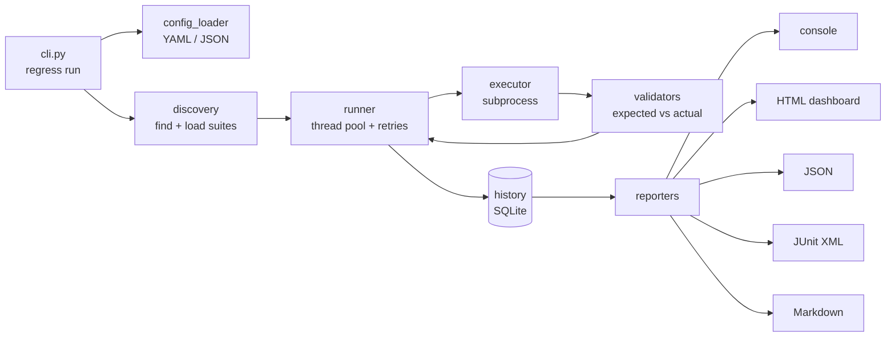

# Regression & Validation Automation Framework


A config-driven regression testing framework written in Python. You describe tests in **YAML or JSON** (no code needed). The framework runs them **in parallel**, **retries** flaky failures, compares **expected vs actual** results, remembers every run in **SQLite** to flag **new regressions**, and produces an **interactive HTML dashboard** plus **JUnit XML** for CI/CD.

```text
$ regress run

Running 20 test(s) with 4 worker(s), 1 retr(y/ies)

   PASS  calculator_add                               0.04s
   FAIL  order_with_coupon_us                         0.08s  $.tax: expected 6.48, got 7.2
  FLAKY  health_after_cold_start                      0.14s  passed on attempt 2
   FAIL  health_response_time                         1.77s  Too slow: took 1.77s, limit is 1.00s
   ...
Compared with run #3
  4 NEW FAILURE(S): order_with_coupon_us, order_with_coupon_uk, order_receipt_snapshot, health_response_time

 FAILED  15 passed, 4 failed, 1 flaky, 1 skipped  | pass rate 78.9%
Finished in 4.1s (total test time 9.0s, 2.2x faster with 4 workers)
```

**Tech stack:** Python · PyTest · subprocess · YAML/JSON · SQLite · Jinja2 · Git · GitHub Actions

---

## Features

| Area | What it does |
|---|---|
| **Test discovery** | Finds every `test_*.yaml` / `test_*.json` file under `test_suites/`, including sub-folders. Suite-level `defaults` keep files short. |
| **Execution** | Runs each test as a separate process (`subprocess`), with timeouts, stdin input and environment variables |
| **Parallelism** | Runs tests concurrently with a thread pool and reports the speed-up |
| **Validation** | Checks exit code, exact output, contained text, regex, JSON fields (with exact paths like `$.order.tax`), stderr, a **performance budget**, and **golden-file snapshots** with diffs |
| **Retries & flaky detection** | Retries a failed test (globally or per test). A test that passes only on a retry is reported as **FLAKY**. |
| **Run history** | Saves every run to SQLite with its Git commit, and labels each test as a **new failure**, **fixed**, or **still failing** compared with the previous run |
| **Reporting** | Colour console output, an HTML dashboard (trend chart, filters, search, diffs), JSON, JUnit XML, and a Markdown summary |
| **Logging** | All modules log to one place: a full debug log in `logs/regression.log` and a quiet console |
| **CLI** | `regress run / list / history`, with `--tags`, `-k`, `--workers`, `--retries` and `--update-snapshots` |
| **CI/CD** | GitHub Actions: lint, unit tests on Python 3.10 and 3.12 with a 90% coverage minimum, regression suites, a run-page summary, report artifacts, and a nightly scheduled run |

---

## Architecture



Each module has a single responsibility and can be tested on its own:

```
regression_framework/
├── cli.py              # `regress` command: run / list / history
├── config_loader.py    # read + validate YAML/JSON settings
├── discovery.py        # find suite files, apply defaults, filter by tag/name
├── models.py           # TestCase, TestResult, RunReport, Comparison (dataclasses)
├── executor.py         # run one command with subprocess (timeout, stdin, env)
├── validators.py       # one small function per check, listed in CHECKS
├── runner.py           # ThreadPoolExecutor + retry loop + live progress callback
├── history.py          # SQLite run history + new-failure detection
├── git_info.py         # current commit / branch
├── logger.py           # centralized logging setup
├── reporters/          # console, html, json, junit, markdown
└── templates/          # Jinja2 HTML dashboard template
```

**Key design decisions**

- **Configuration over code.** Anyone can add a test by editing a YAML file, without writing Python.
- **Language-agnostic.** Tests are just commands, so the framework can test a program written in any language.
- **Threads, not processes, for parallelism.** Each worker spends its time waiting on a child process, so Python's GIL doesn't slow it down.
- **Pluggable checks.** Every validation is a plain function in a `CHECKS` list. Adding a new check type takes about five lines.
- **Fail loudly on bad input.** Unknown config keys, misspelled test fields and duplicate test names stop the run with a clear message, instead of being silently ignored.
- **Meaningful exit codes** (`0` pass, `1` test failures, `2` setup error), so any CI system can gate on the result.

---

## Quick start

```bash
python3 -m venv .venv
source .venv/bin/activate              # Windows: .venv\Scripts\activate
pip install -e ".[dev]"                # installs the `regress` command

regress run                            # run every suite
open reports/report.html               # view the dashboard (Windows: start, Linux: xdg-open)
```

Using `make` (macOS / Linux):

```bash
make install    # install
make regress    # run all suites
make demo-bug   # run against a deliberately buggy build
make report     # open the HTML dashboard
make coverage   # unit tests + coverage
make help       # list every shortcut
```

### CLI reference

```bash
regress run                              # all tests
regress run --tags smoke                 # only tests tagged "smoke"
regress run -k order                     # only tests whose name contains "order"
regress run --workers 8 --retries 2      # override config values
regress run --update-snapshots           # (re)record golden files
regress run --config config/config.ci.json
regress list --tags negative             # show what would run
regress history --limit 10               # recent runs, pass rates, commits
```

---

## Writing tests

Create `test_suites/<area>/test_<feature>.yaml` (or `.json`):

```yaml
defaults:                         # optional, applied to every test in this file
  tags: [orders]                  # tags are combined with each test's own tags
  command: python sample_app/order_service.py quote

tests:
  - name: order_with_coupon_us    # required, must be unique across all suites
    description: Tax must be charged on the price AFTER the discount
    stdin: '{"items": [{"sku": "BOOK", "price": 40, "qty": 2}], "coupon": "SAVE10"}'
    expected_json: {subtotal: 80.0, discount: 8.0, total: 77.76}
    tags: [smoke]
```

### All test fields

| Field | Purpose |
|---|---|
| `name` *(required)* | Unique test name, used in reports and history |
| `command` *(required)* | String or list. A leading `python` uses the framework's own interpreter. |
| `description` | Shown in reports |
| `tags` | Labels for `--tags` filtering |
| `stdin` | Text sent to the program's standard input |
| `env` | Extra environment variables, e.g. `{API_URL: http://localhost}` |
| `timeout` | Seconds before the test is stopped and failed |
| `retries` | Per-test retry count (overrides the config) |
| `skip` | `true` or a reason string |
| `expected_exit_code` | Default `0` |
| `expected_output` | Exact stdout (trailing whitespace ignored, diff shown on mismatch) |
| `expected_output_contains` | List of strings that must appear in stdout |
| `expected_output_regex` | Regular expression that must match stdout |
| `expected_json` | stdout must be JSON containing these keys and values (extra keys allowed) |
| `expected_stderr_contains` | List of strings that must appear in stderr |
| `expected_output_file` | Golden snapshot file. Create or refresh it with `--update-snapshots`. |
| `max_duration` | Performance budget in seconds |

Every test process also receives `REGRESS_TEST_NAME` and `REGRESS_ATTEMPT` environment variables.

## Configuration

`config/config.yaml` (command-line options override these values):

```yaml
test_dir: test_suites
report_dir: reports
log_dir: logs
log_level: WARNING               # console only; the log file records everything
workers: 4
retries: 1
retry_delay: 0.2
default_timeout: 30
tags: []
history_db: .regress/history.db  # "" disables history
```

---

## Testing the framework itself (PyTest)

```bash
pytest tests/unit                       # 110+ unit and end-to-end tests
pytest tests/unit --cov                 # with coverage (currently ~98%)
pytest -m regression -v                 # run the YAML suites as PyTest tests
```

## CI/CD pipeline

`.github/workflows/regression.yml` runs on every push to `main`, on every pull request, nightly at 02:00 UTC, and on demand.

```
quality (Python 3.10 + 3.12)          regression (needs: quality)
 ├─ ruff lint                          ├─ regress run --config config/config.ci.json
 └─ pytest + coverage ≥ 90%            ├─ summary.md → GitHub run page
                                       └─ upload reports/ + logs/ as artifacts
```

A failing regression test fails the pipeline, which blocks the merge when branch protection is enabled.

---

## Demo application

`sample_app/` contains three small programs for the framework to test:

| App | Demonstrates |
|---|---|
| `calculator.py` | Exact output, exit codes, stderr checks |
| `order_service.py` | stdin input, JSON field checks, regex, golden-file receipt |
| `health_service.py` | Performance budget, flaky dependency (cold start), skipped test |

Setting `DEMO_BUG=1` introduces two realistic bugs: tax is calculated before the discount, and the health check slows down. Run `make demo-bug` to watch the framework catch them. See [docs/DEMO.md](docs/DEMO.md) for a step-by-step demo script.
